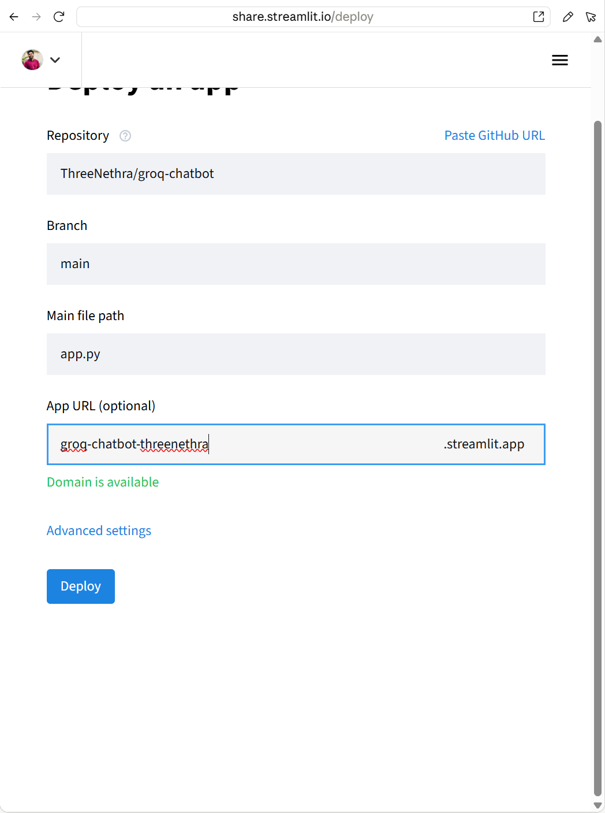
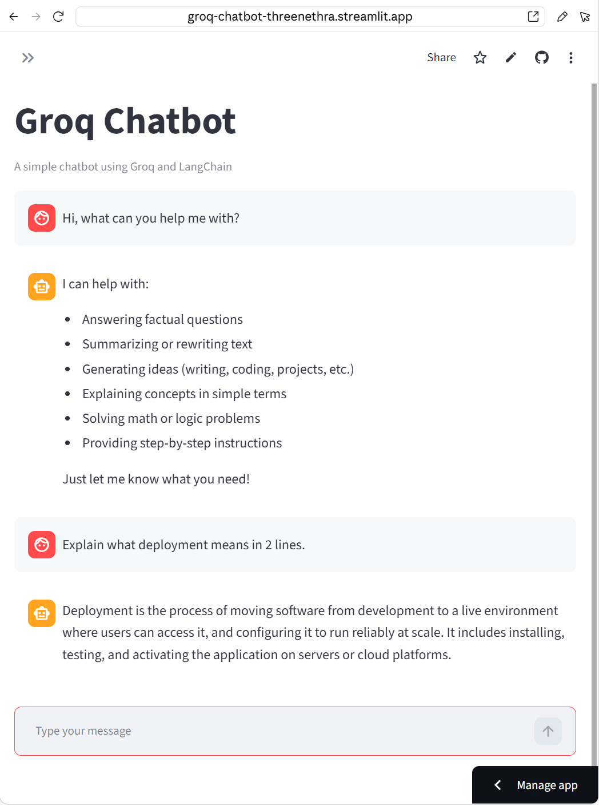
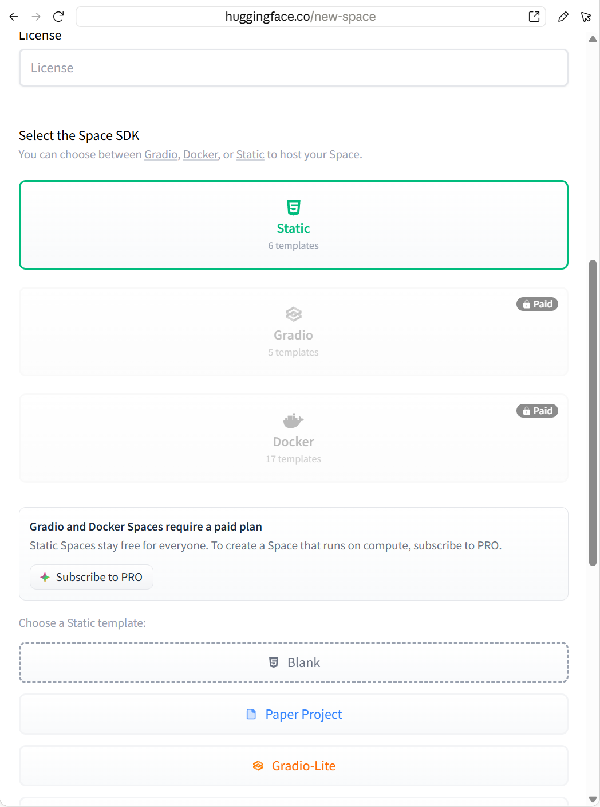
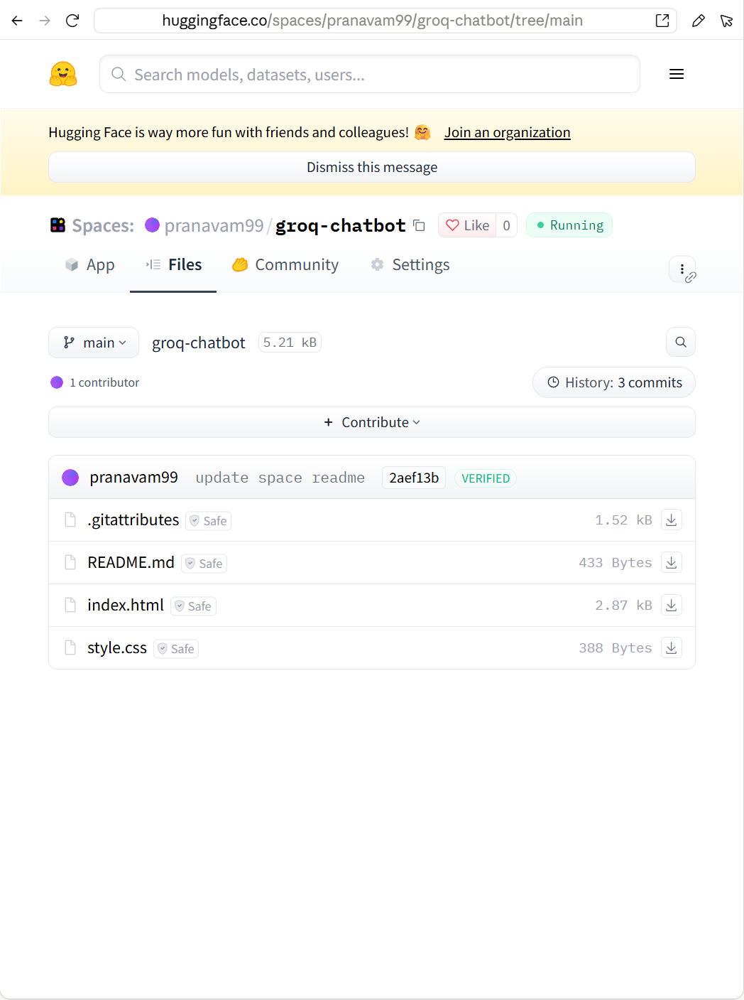
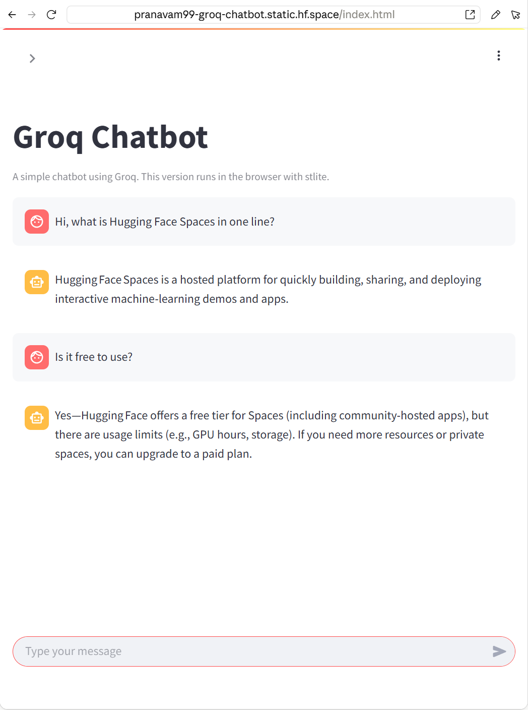

# Assignment 39 - GenAI App Deployment

A Groq chatbot (Streamlit + LangChain + ChatGroq) deployed on Streamlit Cloud and on Hugging Face Spaces.

## Links

| | Link |
|---|---|
| GitHub repo | https://github.com/ThreeNethra/groq-chatbot |
| Streamlit Cloud app | https://groq-chatbot-threenethra.streamlit.app |
| Hugging Face Space | https://huggingface.co/spaces/pranavam99/groq-chatbot |
| Space direct link | https://pranavam99-groq-chatbot.static.hf.space |

## Files

- `app.py` - the chatbot (chat history in session state, model and temperature in the sidebar, streamed answers)
- `requirements.txt`
- `huggingface_space/index.html` and `huggingface_space/README.md` - the files of the Hugging Face Space
- `screenshots/`

## The app

`app.py` uses `ChatGroq` with `openai/gpt-oss-120b`. The API key is not in the code. It is read from `GROQ_API_KEY`, first from the environment and then from `st.secrets`, and the app shows an error and stops if it is missing.

Run locally:

```
pip install -r requirements.txt
set GROQ_API_KEY=your_key
streamlit run app.py
```

## Task 1 - Streamlit Cloud

1. Created the repo on GitHub and pushed the project (`git init`, `git add`, `git commit`, `git push`). The repo has `app.py` and `requirements.txt` in the root.
2. Signed in to share.streamlit.io with GitHub and chose "Deploy a public app from GitHub".
3. Repository `ThreeNethra/groq-chatbot`, branch `main`, main file `app.py`, and a custom app URL.
4. In Advanced settings added the secret in TOML format: `GROQ_API_KEY = "..."`.
5. Clicked Deploy. The app was live a few minutes later.



Tested the live URL with two messages, both answered:



## Task 2 - Hugging Face Spaces

This did not go as the assignment describes, so writing down what happened.

- The "Streamlit" Space type does not exist anymore. The Hugging Face docs say the built-in Streamlit SDK is deprecated and a Streamlit app has to be deployed as a Docker Space with the Streamlit template.
- When creating the Space, Gradio and Docker were both marked "Paid" for my account, with the message "Gradio and Docker Spaces require a paid plan. Static Spaces stay free for everyone." So on a free account only a Static Space can be created.



So I deployed the chatbot as a **Static Space** using **stlite**. stlite runs Streamlit inside the browser with Pyodide (Python compiled to WebAssembly), so there is no server at all, the Space only serves one `index.html`.

Steps:

1. Created a new Space `groq-chatbot`, SDK Static, Blank template, public.
2. Replaced `index.html` with a page that loads stlite from the CDN and has the Streamlit code inside a `<streamlit-app>` tag.
3. Configured `README.md`. The YAML block at the top is the Space configuration:

```yaml
---
title: Groq Chatbot
emoji: 💬
colorFrom: blue
colorTo: indigo
sdk: static
pinned: false
short_description: Streamlit chatbot with Groq (stlite)
---
```

4. Committed the files, the Space went to "Running" immediately since there is nothing to build.



Differences from the Streamlit Cloud version:

- A static site cannot keep a secret, anything in the page can be read by the visitor. So the key is not stored in the Space. The user enters their own Groq key in the sidebar (password field) and it is only sent from the browser to the Groq API.
- `langchain-groq` is not used there. The app calls the Groq REST endpoint with `requests`, because not every package works in Pyodide and the page should load fast. The chat logic is the same.
- First load can take up to about 30 seconds because the browser has to download Pyodide.

Tested with my key, two messages including a follow-up, and it also shows a warning if no key is entered:



## Task 3 - Comparison

**1. Streamlit Cloud vs Hugging Face Spaces**

| | Streamlit Cloud | Hugging Face Spaces |
|---|---|---|
| What it runs | only Streamlit apps | Gradio, Docker (which covers Streamlit, FastAPI etc.) and static sites |
| Source of code | a GitHub repo | the Space itself is a git repo on Hugging Face (files can be edited or uploaded in the browser, or pushed with git) |
| Setup | pick repo, branch and file, click Deploy | create Space, choose SDK, add files, set README config |
| Secrets | TOML box in the app settings, available as `st.secrets` | "Secrets" in Space settings, available as environment variables (not for static Spaces) |
| Updates | redeploys automatically on every push to GitHub | rebuilds on every commit to the Space |
| Free plan (what I saw) | free for public apps | only Static Spaces were free on my account, Gradio and Docker asked for PRO |
| Hardware | CPU only | CPU, and GPU can be added as paid hardware |

**2. Pros and cons**

Streamlit Cloud
- Pros: easiest way to deploy a Streamlit app, a few clicks from a GitHub repo. Free. Secrets are simple. Auto redeploy on push.
- Cons: only for Streamlit. No GPU. Apps go to sleep when not used. Code has to be on GitHub.

Hugging Face Spaces
- Pros: not tied to one framework, with Docker anything can be deployed. Part of the Hugging Face hub, so it is close to models and datasets and easy for other ML people to find. GPU hardware is available. Static Spaces are free.
- Cons: for a Streamlit app it is now more work (Dockerfile, port 8501) and on my account it needs a paid plan. More configuration (README YAML). The free static option has no backend, so no secrets and only packages that run in the browser.

**3. When to use which**

- Streamlit Cloud: when the app is a Streamlit app that calls an API (like this Groq chatbot) and it just needs to be online quickly for a demo or a class project.
- Hugging Face Spaces: when the app is a model demo that should live next to the model on the hub, when it needs a GPU, when it is built with Gradio, or when it needs a custom Docker setup. A Static Space is fine for small demos that can run fully in the browser.

For this chatbot Streamlit Cloud was clearly the better fit: same code as local, the key stays hidden on the server, and it took a few minutes.
